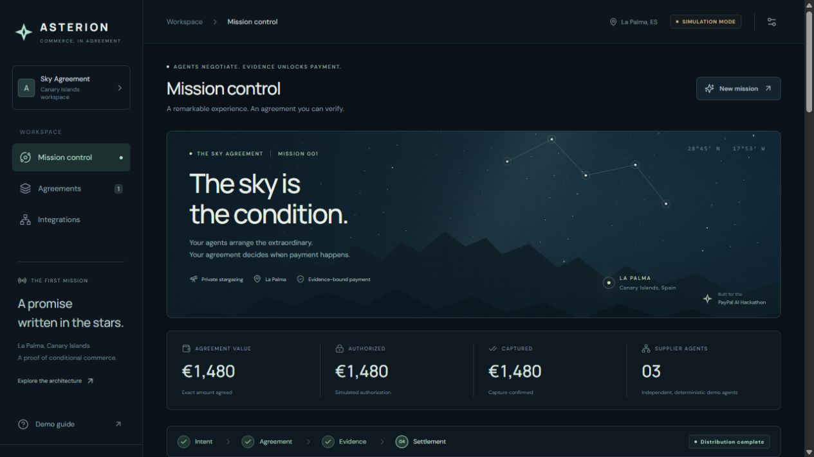
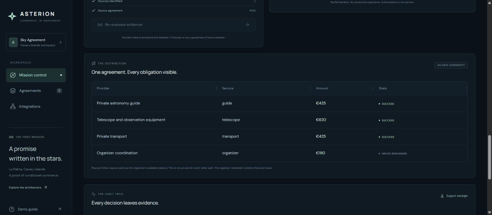

# ASTERION

**Intent. Evidence. Payment.**

[Open the public demo](https://asterion-mj13.onrender.com/) · [Verified CI run](https://github.com/Enrickq/asterion-commerce/actions/runs/39757019170)



ASTERION is a working prototype for conditional agentic commerce. A buyer agent negotiates a complete stargazing experience in La Palma with supplier agents. The customer approves an explicit spending mandate and arms Autopilot. A persisted server job then evaluates evidence, captures or voids the authorization, and requests separate supplier payouts without further clicks.

The product question is simple: **can an agent explain why money should move, and prove why it did not move when conditions failed?**

The default experience runs locally without accounts or API keys. It uses reproducible negotiation, weather fixtures and simulated payments, clearly identified as demo data. **Actual PayPal Sandbox authorization, capture, separate supplier Payouts and a cloudy-condition void were verified on October 22, 2026** in a private local environment. Further approved mandates completed both outcomes autonomously. See the [sanitized provider evidence](docs/evidence/paypal-sandbox.json). On October 23, Canary Islands time, **three actual Gemini supplier calls produced a €1,650 agreement within a €1,700 mandate**; see [model evidence](docs/evidence/gemini-verification.json). Live weather and webhook delivery remain unverified.

The same Gemini-negotiated agreement subsequently completed buyer-approved PayPal Sandbox authorization, autonomous capture and three validated supplier payments. [Integrated AI → Sandbox evidence](docs/evidence/ai-sandbox-run.json) records the €1,650 capture and €425/€620/€425 Payouts. The public hosted demo retains simulated payments and deterministic agents.

## Run locally

Requirements: Node.js **24 or newer** and pnpm **11**. Node's built-in SQLite module stores agreements and their audit history.

```powershell
pnpm install
Copy-Item .env.example .env
node scripts/preflight.mjs
pnpm dev
```

Open [localhost:5173](http://localhost:5173). The API listens on [localhost:8787](http://localhost:8787). Keep the terminal running.

```powershell
pnpm test
pnpm build
pnpm smoke
pnpm start
```

After a production build, the Node server serves the application and API from port 8787. The development frontend proxies API requests to the backend.

## What to try

1. Submit a mandate for a private La Palma stargazing experience within the displayed budget.
2. Review supplier offers and the negotiated bundle in the AG Grid operations table.
3. Accept the mandate and authorize payment. In demo mode these are local simulations; in PayPal Sandbox the buyer must approve through PayPal.
4. Select a clear-sky fixture and arm Autopilot. A job is saved in SQLite and scheduled three seconds later; watch the server evaluate, capture and disburse without another action.
5. Start a separate agreement with cloudy or stale evidence and arm it. The server voids the authorization without capture; inspect the audit receipt and job outcome.

The default two-person scenario trades 20 minutes of schedule flexibility for a €1,480 bundle within a €1,500 mandate. With fixed timing the €1,680 opening offer cannot fit that mandate. These are simulated commercial offers, not quotes from actual La Palma operators.

The Spanish [demo script](docs/DEMO.es.md) includes a 2 minute 50 second presentation and the boundary between fixtures and external services.

Autopilot is a real server scheduler, including in the simulated-payment demo. Jobs are persisted before the arm request returns and can resume after a process restart if the database survives. This does not make the free hosting filesystem durable. Manual controls remain available for diagnostics when an autonomous job is not active.

## Payment model

This prototype uses **one organizer merchant** for the customer transaction. PayPal authorization and capture are separate operations. Supplier disbursements are subsequent Payouts operations from the organizer's prefunded balance, or a visibly simulated ledger in demo mode. They are **not an atomic split of a checkout payment**.

An authorization is not an escrow service. Voiding an authorization is not refunding a captured payment, and the issuing provider controls when an authorization hold disappears. ASTERION evaluates an application policy; it does not install a smart contract inside PayPal. PayPal documents a 29-day authorization window and recommends capture within its initial three-day honor period; later capture is not guaranteed. See the [official authorize and capture guide](https://developer.paypal.com/docs/checkout/standard/customize/authorization/).

## Integrations and current scope

| Component | Repository status | External verification |
| --- | --- | --- |
| AG Grid Community | Real React operations grid | No cloud account required |
| Local agent negotiation | Reproducible deterministic execution | No foundation model used in default mode |
| PayPal | Sandbox-only order, authorization, capture/void and Payouts adapter | Actual capture, void and three individual Payouts verified; autonomous clear and cloudy outcomes verified; webhooks pending |
| Anthropic | Optional model adapter | Requires API key and explicit model choice |
| Google Gemini | Optional model adapter with three isolated supplier contexts | Complete private negotiation verified with `gemini-3.1-flash-lite`; [evidence](docs/evidence/gemini-verification.json) |
| AEMET | Optional observation adapter | Requires API key and station ID; incomplete evidence fails closed |
| Render | Free public demo deployed in Frankfurt | Hosted Autopilot clear/cloudy flows verified; [verification record](docs/VERIFICATION.es.md) |
| APIMatic | PayPal Context Plugin installed and used for implementation review | Development aid; [evidence](docs/APIMATIC-CONTEXT.md), no generated SDK or runtime integration claim |
| Kernel | Optional browser-session adapter | Requires credentials and server-configured destination; no booking claim |
| Astropods, Elastic, Channel3 | Planned extensions | Not active integrations |

The definitive implementation notes and account requirements are in [INTEGRATIONS](docs/INTEGRATIONS.md) and [ACCOUNTS.es](docs/ACCOUNTS.es.md). A planned integration does not qualify as a completed sponsor submission.



## Deployment

The [public demo](https://asterion-mj13.onrender.com/) runs on Render Free with auto-deploy disabled. Application commit `6003fd5` and both simulated autonomous outcomes were verified on October 23, 2026, Canary Islands time. Private Sandbox runs use separate local credentials and data; their evidence records retain their historical application baseline. Verification records distinguish application revisions from documentation updates.

[render.yaml](render.yaml) prepares a free public demo with `PUBLIC_DEMO=true`, simulated payments and SQLite under `/tmp/asterion`. Guest sessions use signed HttpOnly cookies; agreements and receipts are scoped to that browser's session. The server blocks PayPal Sandbox payments and Kernel launches in public-demo mode.

**The free hosted demo has ephemeral storage:** agreements and session signing keys can disappear on redeploy, restart or idle spin-down. A cold start can delay the first visit. Local SQLite persists under `DATA_DIR`; this does not make the free hosted filesystem persistent. See [Render free-service limits](https://render.com/docs/free).

[render.persistent.yaml](render.persistent.yaml) is an optional paid template with one `0.5c-512mb` service and a 1 GB persistent disk at `/var/data`. Applying it incurs compute and disk charges and requires separate budget approval. Neither file deploys resources by itself. Review [Render pricing](https://render.com/pricing) before selecting a paid option.

Sandbox testing belongs in a private environment with `PUBLIC_DEMO=false`. Guest sessions are not verified user identities or an operator authorization system. The [architecture notes](docs/ARCHITECTURE.md) describe the production work still required.

## Location and evidence

The story is set around Roque de los Muchachos, La Palma. Public telescope visits are offered during daylight; the nighttime experience must use a permitted nearby site and the operator's own equipment. The prototype does not imply an IAC partnership or access to research telescopes. See [IAC visits](https://iac.es/es/observatorios-de-canarias/observatorio-del-roque-de-los-muchachos/visitas) and [La Palma tourism guidance](https://visitlapalma.es/observacion-de-estrellas/la-palma/roque-de-los-muchachos/).

Weather thresholds are demo policy parameters, not a scientific guarantee of a perfect sky. Forecasts, local observations, freshness and availability have different meanings. Missing or stale evidence must not become a positive observation.

## Project notes

- [Architecture and trust boundaries](docs/ARCHITECTURE.md)
- [Integration matrix and configuration](docs/INTEGRATIONS.md)
- [APIMatic installation and review evidence](docs/APIMATIC-CONTEXT.md)
- [Spanish demo narration](docs/DEMO.es.md)
- [Devpost submission draft](docs/SUBMISSION.md)
- [Accounts and user setup, in Spanish](docs/ACCOUNTS.es.md)
- [Public deployment verification](docs/VERIFICATION.es.md)

MIT licensed. Built as a hackathon prototype; no real-money or production readiness claim.
