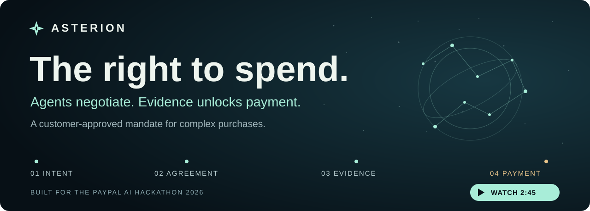
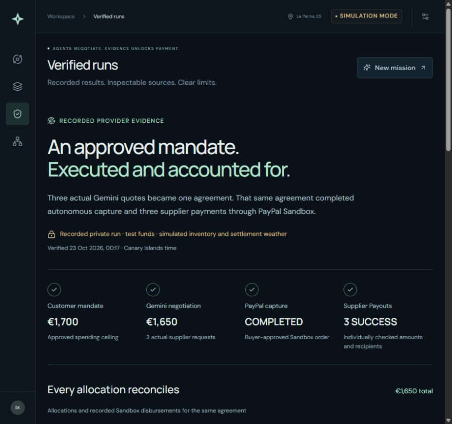
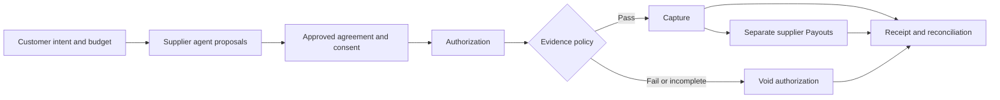

# ASTERION



[](https://github.com/Enrickq/asterion-commerce/actions/workflows/ci.yml) · [MIT](LICENSE) · Node.js 24 · React · PayPal Sandbox

**[Try the demo](https://asterion-mj13.onrender.com/) · [Inspect verified runs](https://asterion-mj13.onrender.com/#verified-runs) · [Pitch deck](docs/presentation/ASTERION-Pitch.en-2026-10-27.pptx) · [Launch-film script](docs/video/ASTERION-Launch-Script.en.md)**

ASTERION helps experience organizers coordinate one outcome across several suppliers, with payment governed by the buyer's approved conditions. Its first mission is a private stargazing experience in La Palma: guide, telescope and transport under one spending mandate.

Agents propose the bundle. The customer approves its exact price, allocations and evidence policy. The server then checks the evidence and autonomously captures or voids the authorization. Supplier Payouts follow capture as separate operations.

**The model can negotiate. It cannot grant itself permission to spend.**

## The proof

Three actual Gemini supplier requests produced a **€1,650 agreement within a €1,700 mandate**. That same buyer-approved agreement completed PayPal Sandbox capture and three individually confirmed supplier Payouts: **€425 + €620 + €425**. The organizer retained a **€180 gross remainder before fees and taxes**.

[Inspect the agreement, provider references and allocations](docs/evidence/ai-sandbox-run.json).



| Run | Observed result | Evidence and scope |
| --- | --- | --- |
| Gemini and PayPal Sandbox | Actual quotes, completed capture, three `SUCCESS` Payouts | [Recorded private run](docs/evidence/ai-sandbox-run.json). Test funds, simulated inventory and settlement weather. |
| Separate cloudy agreement | Authorization voided, no capture or supplier Payouts | [Sandbox record](docs/evidence/paypal-sandbox.json). A different approved agreement with fixture weather. |
| Public walkthrough | Server Autopilot completes clear and cloudy paths | [Try it](https://asterion-mj13.onrender.com/). Deterministic agents, fixture weather, simulated payments. |
| Browser receipt export | Complete settled and voided receipts pass the offline verifier | [Browser verification](docs/evidence/browser-receipt-verification.json). Internal consistency, not provider authentication. |
| External forecast preview | Model forecast with validity, update and retrieval times | [MET Norway record](docs/evidence/weather-preview.json). Read-only planning data. |

Records retain their original dates and software baselines. They summarize private runs and authenticated provider queries; they are not signed provider attestations. Complete local observations, actual operator bookings and webhook delivery remain unverified.

## Try the complete flow

1. Open **Mission control**. Keep the two-person brief, €1,500 ceiling and 20-minute flexibility.
2. Negotiate the **€1,480** bundle. Inspect the approved terms and supplier allocations.
3. Grant consent and simulate authorization. Select clear skies, then **Arm autonomous execution**.
4. Watch the server evaluate the evidence, complete capture and confirm the three supplier states without another payment click.
5. Start a **new mission** with the cloudy scenario. Arm it and inspect the voided authorization and absent capture.
6. Export either receipt and check it locally:

```sh
pnpm verify:receipt path/to/asterion-receipt.json
```

No account or keys are needed for the public walkthrough. The free Render service can take a cold start, and its storage is ephemeral. Start a fresh mission if an old session has expired. Public payments, offers and weather scenarios are explicitly simulated.

The [2:45 launch film](docs/video/ASTERION-Launch-Production.en.md) is exported locally for owner review. Its script, aligned captions and [human voice recording guide](docs/video/RECORD-YOUR-VOICE.es.md) are available. The public YouTube URL and final Devpost submission are pending.

## Run locally

Install **Node.js 24 or newer** and **pnpm 11**. Default mode needs no environment file or paid service.

```sh
pnpm install --frozen-lockfile
node scripts/preflight.mjs
pnpm dev
```

Open [localhost:5173](http://localhost:5173). The frontend proxies requests to the API at [localhost:8787](http://localhost:8787). Keep the terminal running.

Run checks in a second terminal:

```sh
pnpm test
pnpm build
pnpm smoke
```

For a production-style local preview, stop the development server and run:

```sh
pnpm start
```

After building, `pnpm start` serves the application and API from port 8787. Node's built-in SQLite stores agreements, audit events and scheduled jobs. Commands work on Windows, macOS and Linux. Optional adapters use [.env.example](.env.example); see [configuration](docs/INTEGRATIONS.md).

## How authority becomes execution



The application validates model proposals before persisting the agreement. Autopilot saves a scheduled job before acknowledging the arm request, then evaluates evidence and settles on the server. Jobs resume after a restart **when the database survives**. Model contexts receive quote tools; payment tools and credentials stay on the server.

**One organizer is the merchant.** Authorization, capture, void and Payouts are separate operations. Payouts use the organizer's available balance. The prototype provides neither escrow nor an atomic multi-seller split. Uncertain provider results remain unresolved until reconciliation. [Architecture](docs/ARCHITECTURE.md) · [Receipts](docs/RECEIPTS.md).

## Integrations that are evidenced

| Component | Current use |
| --- | --- |
| PayPal Sandbox REST APIs | Buyer approval, authorization, conditional capture or void, separate Payouts and reconciliation. Recorded outcomes are linked above. |
| Google Gemini | Three isolated supplier contexts produced the agreement that subsequently settled in Sandbox. [Request metadata](docs/evidence/gemini-verification.json). |
| AG Grid Community | Actual React operations grid for offers and supplier obligations. |
| Render | Free public web service in Frankfurt. Hosted clear/cloudy execution and complete receipt downloads verified. [Deployment record](docs/VERIFICATION.es.md). |
| APIMatic | PayPal Context Plugin installed and consulted during development. [Context evidence](docs/APIMATIC-CONTEXT.md). Development tooling, not a generated runtime SDK. |
| MET Norway | External model forecast for planning, with attribution and an explicit settlement veto. |

Anthropic, AEMET and Kernel have optional adapters with separate verification requirements. Astropods, Elastic and Channel3 are planned extensions. The [full integration matrix](docs/INTEGRATIONS.md) distinguishes implemented adapters from verified external execution. Sponsor eligibility follows the [official rules](https://paypalaihackathon.devpost.com/rules).

<details>
<summary><strong>Deployment, payment windows and field validation</strong></summary>

The public service has auto-deploy disabled. Application revision `a23e4cd` was deployed on 26 October 2026 and passed 143 tests, build, preflight, smoke and actual browser receipt checks. Documentation revisions do not create new provider runs. The [verification record](docs/VERIFICATION.es.md) preserves these distinctions.

[render.yaml](render.yaml) configures `PUBLIC_DEMO=true`, simulated payments and SQLite under `/tmp/asterion`. Signed HttpOnly guest cookies scope agreements and receipts to one browser session. Public mode blocks PayPal Sandbox execution and Kernel launches. Guest sessions are not verified operator identities. The free filesystem and signing keys can disappear on restart, redeployment or idle spin-down; see [Render's limits](https://render.com/docs/free).

[render.persistent.yaml](render.persistent.yaml) is an optional paid template, not an active service. Review compute and disk charges before use. Private Sandbox testing belongs in `PUBLIC_DEMO=false` environments. No production-money deployment is claimed.

PayPal documents a 29-day authorization window and recommends capture within the initial three-day honor period. Later capture is not guaranteed. Voiding an authorization differs from refunding a captured payment, and the issuing provider determines when a hold disappears. [Official authorization guide](https://developer.paypal.com/docs/checkout/standard/customize/authorization/).

The use case is set near Roque de los Muchachos. A real nighttime experience needs an operator-confirmed permitted location and the operator's equipment. The prototype does not imply an IAC partnership or access to research telescopes. [IAC visitor information](https://iac.es/es/observatorios-de-canarias/observatorio-del-roque-de-los-muchachos/visitas).

Weather thresholds are illustrative policy parameters. A model forecast cannot establish a perfect sky or replace complete local observations. **Read forecast** does not change an agreement or authorize capture. [Weather contract](docs/WEATHER.md).

</details>

## Delivery materials

| For reviewers | For builders |
| --- | --- |
| [English pitch deck](docs/presentation/ASTERION-Pitch.en-2026-10-27.pptx) and [manuscript](docs/PITCH.en.md) | [Architecture](docs/ARCHITECTURE.md) |
| [English launch script](docs/video/ASTERION-Launch-Script.en.md) and [Spanish translation](docs/video/ASTERION-Launch-Script.es.md) | [Integration matrix](docs/INTEGRATIONS.md) |
| [Narration, captions and production provenance](docs/video/) | [Receipt verifier](docs/RECEIPTS.md) |
| [Devpost copy](docs/SUBMISSION.md) and [readiness review](docs/SUBMISSION-READINESS.en.md) | [Verification history](docs/VERIFICATION.es.md) and [changelog](CHANGELOG.md) |
| [Delivery checklist](docs/DELIVERY.es.md) | [Optional account setup](docs/ACCOUNTS.es.md) |

MIT licensed. Built for the PayPal AI Hackathon 2026. Video publication, participant eligibility and final submission remain pending owner review.
