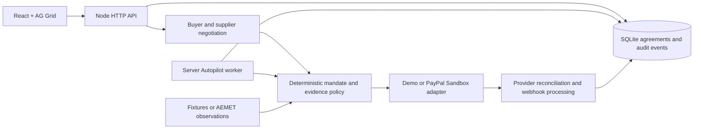

# Architecture

ASTERION separates a proposal to spend from permission to spend. Language models may propose a bundle; the application owns the mandate, monetary arithmetic, policy evaluation and payment transition.

## Runtime



Node.js 24+ runs the HTTP server and built-in SQLite database. Vite provides the React development frontend on port 5173. The API defaults to port 8787 and the loopback interface. A production build is served by the same Node process. SQLite lives at `DATA_DIR/asterion.sqlite`. Local data persists; the default free Render Blueprint uses ephemeral `/tmp/asterion`. Only the optional paid template mounts a persistent disk.

The current deployment model is one process and one SQLite database. The optional paid disk remains single-instance. Do not attach this database to multiple service instances. A later scale-out design would move storage to a transactional managed database and work execution to a durable queue or workflow service.

## Agreement lifecycle

```text
NEGOTIATED → CONSENTED → ORDER_CREATED → AUTHORIZED
                                             ↓
                           CONDITION_MET / CONDITION_FAILED
                                  ↓                 ↓
                      CAPTURED / CAPTURE_PENDING   VOIDED
                                  ↓
                       PAYOUTS_PENDING / SETTLED
```

The customer approves a spending mandate before a payment order is created. In PayPal Sandbox the customer also approves that order in PayPal. An order ID is not an authorization ID, and an authorization ID is not a capture ID. The backend retains these distinctions for later evidence and reconciliation.

## Autonomous execution

After authorization, `POST /api/agreements/:id/autopilot` with `{ "scenario": "clear" }` saves an `ARMED` job and a run time three seconds in the future. The response returns only after SQLite persists that delegation. The Node server checks due jobs every 250 ms, claims the job, evaluates evidence and executes the appropriate capture or void path. A completed capture permits separate supplier payouts. The browser polls state; it does not trigger these financial steps.

Job state progresses `ARMED → RUNNING → COMPLETED`, with a `SETTLED` or `VOIDED` outcome. Unresolved provider responses remain pending and are reconciled; review failures use a `FAILED` job state with a safe error message. Manual execution controls are guarded while the job is active. Stable provider operation IDs and saved financial states support recovery after a process restart when the SQLite database remains available. The test suite includes restart recovery; the smoke script arms jobs and then makes only read requests until completion.

Sandbox Autopilot is disabled by default. A private test deployment must enable `ALLOW_SANDBOX_AUTOPILOT=true`, and the arm payload must also contain `confirmSandboxAutopilot: true` and the exact `agreementHash`. `PUBLIC_DEMO=true` blocks Sandbox use regardless. The three-second timer and fixture scenarios demonstrate scheduling; they are not a guarantee of a multi-day payment hold or a prediction of real weather.

The policy requires acceptable evidence before capture. Failure selects the void path. A provider timeout or pending response cannot be relabeled as completed. Supplier disbursements follow a completed customer capture; they are distinct operations that can have independent pending or failure states.

## Trust boundaries

- **User mandate:** the authoritative spending limit and approved experience. Negotiation text cannot change it silently.
- **Agent output:** a proposal validated by application code. The default mode is deterministic simulation; Anthropic is explicit opt-in.
- **Weather source:** external evidence with freshness and completeness requirements. Missing cloud information is not zero cloud cover.
- **Payment provider:** authoritative provider status. Demo payment IDs are local artifacts, not PayPal transaction IDs.
- **Browser:** presentation and customer input. API credentials remain on the server and must never use `VITE_` variables.

The evidence receipt records the information used for a decision. A hash detects changes relative to a recorded value; it is not an independent signature by AEMET or PayPal, proof of future weather, or a legal guarantee of performance.

## Conditional payment design

The organizer is the merchant for one customer transaction. PayPal Orders v2 authorizes the order; Payments v2 captures or voids that authorization. Supplier allocations are an application ledger followed by separate Payouts requests. The system does not promise distributed atomicity between the capture and three supplier transfers.

Reconciliation retains explicit `REFUNDED` and `PARTIALLY_REFUNDED` capture states. Further capture, authorization and supplier payment actions are blocked after either is observed, including after restart. A later stale `COMPLETED` result cannot restore spending permission. Existing supplier transfers remain in the record for separate recovery review; a customer refund does not reverse them atomically.

Complete receipt exports preserve every committed event. The [offline verifier](RECEIPTS.md) recomputes hashes and checks internal consistency without contacting a provider. A valid report does not authenticate an external transaction.

An authorization hold is subject to PayPal and funding-source rules. This is neither escrow nor blockchain settlement. See [PayPal authorization guidance](https://developer.paypal.com/docs/checkout/standard/customize/authorization/) and [Payouts documentation](https://developer.paypal.com/docs/payouts/standard/).

## Demo evidence versus field deployment

Fixtures make clear, cloudy and stale-data paths reproducible without dependencies. They must remain labeled in the UI and recording. The optional AEMET adapter uses actual observations from an explicitly configured station; those observations alone may be insufficient for a complete astronomical quality decision, in which case capture stays blocked.

The separate MET Norway preview is a cached, read-only model forecast. It never updates agreement evidence or calls payment methods. Policy 1.1 includes the approved coordinates and location tolerances; actual-evidence settlement requires complete local observations with explicit timestamps, provenance and distinct adapter-declared lineage groups. Forecasts retain an explicit settlement veto. See [weather evidence](WEATHER.md).

Field operation requires a suitable observation location, licensed providers where applicable, a verified weather feed for that location, meaningful source freshness, contractual thresholds and customer cancellation terms. A municipality forecast cannot be silently treated as a mountaintop sensor.

## Work required before public financial use

The demo uses a signed HttpOnly, SameSite=Lax guest-session cookie. Requests are scoped to that session's owner reference: lists contain only its agreements, and IDs belonging to another session return 404. The server persists its signing key in `DATA_DIR/.session-key` unless a `SESSION_SECRET` of at least 32 characters is configured. Clearing the cookie loses the browser's ability to access those agreements. This is guest isolation, not identity verification or account recovery.

`PUBLIC_DEMO=true` rejects non-demo payment adapters, blocks Kernel session launches and applies request limits. Public demo visitors therefore cannot use the server to move Sandbox funds or launch paid browser sessions. The free deployment may reset both SQLite and the signing key on restart, redeploy or idle spin-down. Its signed guest sessions are intended for disposable demonstrations.

Before exposing Sandbox credentials beyond a private testing environment, add verified user authentication and operator authorization, evaluate session/CSRF controls for the final product, rotate secrets and verify webhook routing. Before any production-money use, complete the provider's merchant and Payouts approvals, verify reconciliation and recovery under real failure conditions, obtain the necessary commercial agreements and independently review the payment implementation.

The Render Blueprint deploys a web service only. It does not prove Render Workflows orchestration, high availability, credential validation, disaster recovery or a completed external integration.

## HTTP surface

| Endpoint | Responsibility |
| --- | --- |
| `GET /api/status`, `GET /api/integrations` | Runtime modes and integration readiness |
| `GET /api/weather/preview` | Fixed-location, cached model forecast for planning; no agreement or payment mutation |
| `GET /api/agreements`, `GET /api/agreements/:id` | Read agreement state |
| `POST /api/negotiate` | Propose a bundle from intent, `budgetMinor` and participants |
| `POST /api/agreements/:id/consent` | Approve the exact `agreementHash` |
| `POST /api/agreements/:id/order` | Create the payment order |
| `POST /api/agreements/:id/authorize` | Authorize the approved order with its exact agreement hash |
| `POST /api/agreements/:id/autopilot` | Persist an autonomous job for the selected evidence scenario |
| `POST /api/agreements/:id/evaluate` | Evaluate an allowed evidence scenario |
| `POST /api/agreements/:id/execute` | Capture or void according to freshly checked policy |
| `POST /api/agreements/:id/payouts` | Request separate supplier payments after completed capture |
| `POST /api/agreements/:id/reconcile` | Fetch authoritative payment-provider state |
| `GET /api/agreements/:id/receipt` | Export evidence, terms and audit history as JSON |
| `POST /api/paypal/webhook` | Verify a Sandbox webhook and reconcile matching agreements |
| `POST /api/integrations/kernel/session` | Open a browser session at the server-configured supplier destination |

Mutation endpoints accept a JSON object, including `{}` for actions without parameters. The browser must not supply arbitrary Kernel destinations. The optional session adapter opens a browser; it does not autonomously reserve an experience or certify weather.
