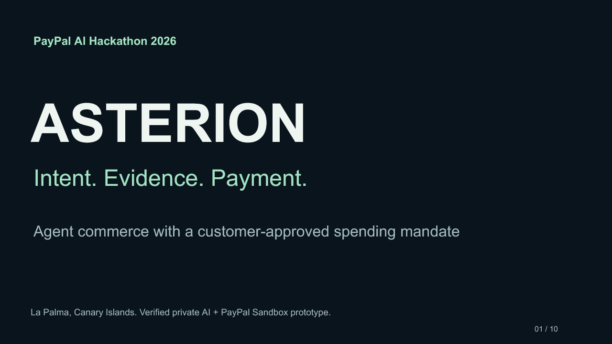

# ASTERION English pitch

[Open the editable PowerPoint](ASTERION-Pitch.en-2026-10-27.pptx)

Ten slides cover the customer mandate, the verified €1,650 Gemini agreement, financial authority, sponsor usage, the demonstration, PayPal operations, evidence, the proposed business model and expansion stages. Text and six tables remain editable. Presenter notes contain the supporting sources and scope of each claim.

The software evidence refers to deployed application revision `a23e4cd` and 143 automated tests. Private Gemini and PayPal Sandbox records retain their historical dates and baselines. Inventory and settlement weather remain simulated. The separate public MET Norway forecast is read-only.

The [extended manuscript](../PITCH.en.md), [launch-film script](../video/ASTERION-Launch-Script.en.md) and [aligned English captions](../video/ASTERION-Launch-Captions.en.srt) follow the current twelve-scene, **2:45** film. Slide 6 summarizes that sequence in six groups. [Production notes](../video/ASTERION-Launch-Production.en.md) distinguish original artwork, captured application steps and historical Sandbox proof. Owner review, a human-voice comparison and YouTube publication remain pending.

The earlier dated PowerPoint editions and 2:50 rehearsal plan remain available as historical versions.
